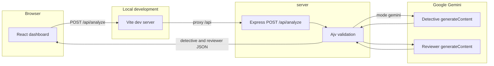

# BugLens AI — Technical Project Report

**Author role:** independent developer and project lead  
**Repository:** `C:\Users\ayaao\buglens-ai`  
**Concord workspace:** `ws_QzpcVXNlcnNcYXlhYW9cYnVnbGVucy1haQ`  
**Report date:** 6 November 2026  
**Status:** working tree, not yet committed to Git

I built BugLens AI to put Concord MCP into practice, explore multi-agent development, and demonstrate that I can design, integrate, debug, and validate a functional AI-powered full-stack application.

This is a self-initiated portfolio project. It is not an official Concord AI assignment, a commissioned product, or an application built by Concord AI. I directed the work. Cursor and Codex implemented the frontend and backend under Concord task ownership. Google Gemini performs the code analysis. Concord MCP coordinates agents; it does not detect bugs.

## Table of contents

1. [Executive summary](#1-executive-summary)
2. [Why I chose to experiment with Concord MCP](#2-why-i-chose-to-experiment-with-concord-mcp)
3. [Problem statement and objectives](#3-problem-statement-and-objectives)
4. [Technology stack](#4-technology-stack)
5. [System architecture](#5-system-architecture)
6. [Multi-agent development with Concord MCP](#6-multi-agent-development-with-concord-mcp)
7. [Development process and task history](#7-development-process-and-task-history)
8. [Implemented features](#8-implemented-features)
9. [Technical challenges and solutions](#9-technical-challenges-and-solutions)
10. [Testing and validation](#10-testing-and-validation)
11. [Security and limitations](#11-security-and-limitations)
12. [Results and screenshots](#12-results-and-screenshots)
13. [Lessons learned](#13-lessons-learned)
14. [Future improvements](#14-future-improvements)
15. [Conclusion](#15-conclusion)
16. [How to run the project](#16-how-to-run-the-project)

## 1. Executive summary

BugLens AI is a local web workspace for inspecting JavaScript and TypeScript. I paste source into a Monaco editor, send it to `POST /api/analyze`, and review three results: a Detective report, a Reviewer verdict, and, when the model produces one, the complete corrected source.

I started the project for two reasons. I wanted a concrete way to evaluate Concord MCP as a coordination tool for more than one coding agent. I also wanted a full-stack piece I could explain to an engineering or recruiting reviewer: architecture, API contract, AI integration, debugging, and tests.

What exists today:

- A React, TypeScript, and Vite client in `client/`, with Tailwind CSS, a dark dashboard, Monaco editing, and a Monaco diff view.
- A Node.js and Express service in `server/` that calls the Gemini `generateContent` API twice, validates both JSON results, and can run in an explicit mock mode.
- Concord records for tasks BL-001 through BL-005, with Cursor on the client and Codex on the server.

What is not finished:

- BL-002 is `review_ready`, not closed.
- The historical HTTP 502 from the analysis provider does not have a retained upstream cause.
- Screenshots are not included in the repository.
- The application is a local developer tool. It has no accounts, persistence, or deployment.

## 2. Why I chose to experiment with Concord MCP

I was interested in an entry-level full-stack role at Concord AI, and I wanted to understand Concord MCP by using it, not by reading a description of it. A single-agent demo would not have shown the part I cared about: two agents editing one repository without colliding.

BugLens was a useful experiment for that. The product has a clear split. The browser owns the editor and presentation. The API owns the model calls, validation, and secrets. I assigned the client to Cursor (`cursor:a5e48e83`) and the server to Codex (`codex:buglens-backend`). Concord held the task IDs, file claims, and handoffs. When the corrected-code feature needed both sides, I opened BL-003 for the server and BL-004 for the client instead of letting one agent edit both trees.

That is the practical result I can point to. Concord did not write the bug detector. It made the ownership visible: who claimed which files, which task was complete, which task was only ready for review, and when a later diagnosis was recorded without changing files.

## 3. Problem statement and objectives

Debugging a snippet usually means jumping between an editor, a runtime error, and a separate chat window. The chat answer is easy to lose, and a partial fix is easy to paste back incorrectly. Security issues are worse: a suggestion can look confident and still leave the original bug in place.

I wanted one workspace where the source, the findings, the review, and the proposed full file stay together.

### Functional objectives

- Edit JavaScript or TypeScript in the browser.
- Submit that source to one analysis endpoint.
- Show findings with severity, an explanation, and a suggested fix when the API provides them.
- Show a second-pass review: approved or not, feedback, and concerns.
- Show the complete corrected source, with copy and a before/after diff, or a clear unavailable state when no fix was generated.

### Technical objectives

- Keep the Gemini API key on the server.
- Validate model output before it reaches the browser.
- Let two coding agents work in parallel through Concord, with `client/` and `server/` as separate claims.
- Make provider failures safe to show and, after BL-005, possible to diagnose from redacted server logs.

## 4. Technology stack

| Technology | Where it is used | Why I used it |
| --- | --- | --- |
| React 19 and TypeScript | `client/` | Component UI with typed analysis results. The client application is TypeScript. The code being analyzed may be JavaScript or TypeScript. |
| Vite 8 | `client/` | Dev server, production build, and the `/api` proxy. |
| Tailwind CSS 4 | `client/src/index.css` via `@tailwindcss/vite` | Dark layout without a separate component library. |
| Monaco Editor 0.57 and `@monaco-editor/react` | Editor, corrected-code view, diff | The same editor family developers already know, including a real diff editor. |
| lucide-react | Sidebar and actions | Small, consistent icons. |
| Node.js | `server/`, engines `>=22` | Runtime for the API and its test runner. This report was checked with Node `v25.6.1`. |
| Express 5 | `server/src/app.js` | HTTP server for `POST /api/analyze`. |
| Ajv 8 | `server/src/schema.js` | JSON Schema checks for requests and both model roles. |
| Google Gemini API | `generateContent` over HTTPS | Structured JSON for the Detective and the Reviewer. There is no Gemini SDK in `package.json`; the server calls the REST API with `fetch`. |
| Concord MCP | Workspace coordination | Task claims, assignment, and handoffs between Cursor and Codex. |
| Cursor | Frontend agent | Implemented `client/` under BL-001 and BL-004. |
| Codex | Backend agent | Implemented `server/` under BL-002, BL-003, and BL-005. |

A third identity, `claude-code:c943cb3f`, appears in the Concord presence list. The work-state file does not assign that identity to BL-001 through BL-005. I do not credit it with BugLens implementation.

## 5. System architecture

The browser never receives the API key. In development, Vite serves the client and proxies `/api` to the Express process. Express either returns the explicit mock payload or calls Gemini twice: Detective first, then Reviewer with the original source and the Detective report. Both payloads are schema-checked before the HTTP response is sent.



Mock mode skips both Gemini calls. It is selected only with `ANALYSIS_MODE=mock`. An unset mode defaults to `gemini` and requires `GEMINI_API_KEY`. Failures do not fall back to mock data.

### Request

`POST /api/analyze` with `Content-Type: application/json`:

```json
{ "code": "function total(items) { return items.length; }", "language": "javascript" }
```

Accepted languages are `javascript` and `typescript`. `code` must be non-blank and at most 50,000 characters. Extra fields are rejected. The JSON body limit is 256 KiB.

### Response

Success returns exactly two objects:

| Field | Meaning |
| --- | --- |
| `detective.summary` | Short explanation of the findings. |
| `detective.bugs[]` | Each item needs `severity` and `explanation`. `title`, `suggestedFix`, and a 1-based `line` are optional. |
| `detective.fixedCode` | Complete proposed source, or `""` when no fix was generated. |
| `reviewer.approved` | Boolean. |
| `reviewer.feedback` | Review text. |
| `reviewer.concerns` | Array of strings. It may be empty. |

Severity values used by the contract are `critical`, `high`, `medium`, `low`, `info`, and `unspecified`. The client labels an unrecognized severity as unspecified rather than guessing.

Errors use `{ "message": "..." }`. Documented statuses include 400, 403, 404, 413, 415, 500, 502, 503, and 504. Analysis failures that reach the client now use the form `Analysis could not be completed. Reference: <id>`. The same id is sent in `X-Request-ID`.

### Data flow for a real analysis

1. The dashboard posts the editor text and the selected language.
2. The Detective prompt asks for bugs, runtime errors, and security vulnerabilities, plus a complete `fixedCode` with no Markdown fences.
3. The server removes one wrapping fence if the entire fix is wrapped. Remaining fence lines are rejected.
4. The Reviewer sees the original source and the Detective report. It does not approve an empty fix.
5. The client renders findings, the review, the corrected editor, and the diff. A blank `fixedCode` becomes the unavailable state.

The prompts tell the model not to claim that generated code is guaranteed secure. Schema validation does not prove that the fix is correct.

## 6. Multi-agent development with Concord MCP

I used Concord because the risk I wanted to manage was overlapping edits, not a lack of autocomplete. Cursor and Codex can both write files. Without a claim, both could edit `client/src/api/analyze.ts` or the response schema at the same time.

The workspace root is `C:\Users\ayaao\buglens-ai`. Concord’s current snapshot shows:

| Agent id | Kind | Role in this project |
| --- | --- | --- |
| `cursor:a5e48e83` | implementation | Frontend. Modules claimed: `client`. |
| `codex:buglens-backend` | codex | Backend. Modules claimed: `server` or `server/`. |
| `claude-code:c943cb3f` | claude-code | Registered. No BugLens task in the work-state file. |

Cursor’s responsibilities were the dashboard, the typed client for `POST /api/analyze`, Monaco, and the corrected-code presentation. Codex’s responsibilities were the Express service, Gemini calls, validation, mock mode, diagnostics, tests, and `server/README.md`.

When I needed a server change from the frontend session, I did not edit `server/`. I created BL-003, assigned it to `codex:buglens-backend`, and sent the contract in a Concord prompt. Codex accepted it. That is the coordination pattern I wanted to demonstrate.

Concord’s practical value here was specific:

- File claims made `client/` and `server/` separate scopes.
- Task status distinguished `complete` from `review_ready`.
- Assignment and acceptance were recorded for BL-003, including version changes `1 -> 2` and `2 -> 3`.
- Later handoffs could record a read-only diagnosis without pretending new code had been written.

Concord is local project state in `.concord/`. It is not the analysis model.

## 7. Development process and task history

All of the following comes from `.concord/WORK_STATE.json`, `.concord/events.jsonl`, `.concord/REVIEW_PACKET.md`, and `.concord/HANDOFF.md`, checked against the source tree. Times are UTC on 6 November 2026. Git cannot corroborate this history: `master` has no commits.

| Task | Title | Owner in the record | Status now | What the record supports |
| --- | --- | --- | --- | --- |
| BL-001 | Build BugLens Frontend | `cursor:a5e48e83` | complete | Claimed `16:52`. Closed `20:07`. Client dashboard, Monaco, and the analyze client. |
| BL-002 | Build BugLens Analysis Backend | `codex:buglens-backend` | review_ready | Claimed `19:14`. Marked review-ready `19:59`. Express API, Gemini roles, mock mode, and the first test pass recorded as 9 tests. Not closed. |
| BL-003 | Complete corrected source | `codex:buglens-backend` | complete | I claimed it at `20:17` and assigned it at `20:17`. Codex accepted at `20:30` and closed it at `20:32`. Later handoffs at `20:41` and `20:46` are also on this task id. |
| BL-004 | Corrected code panel | `cursor:a5e48e83` | complete | Claimed `20:19`. Closed `20:27`. Corrected-code panel, copy, and diff in `client/`. |
| BL-005 | Safe structured backend diagnostics | `codex:buglens-backend` | complete | Claimed `20:50`. Closed `20:53`. Diagnostics module and tests. Further handoffs at `21:06` and `21:15` record a read-only CORS diagnosis and list no changed files. |

### Stages and decisions

**Frontend first (BL-001).** I had Cursor build the dark dashboard and a typed client before the API existed. The decision recorded for that work was that findings render only from a validated response. A local sample in the editor is labeled as a sample. Unknown severity is shown as unspecified. While the API was absent, Analyze produced an HTTP 404 error state rather than a fake report.

**Backend beside it (BL-002).** Codex added `server/` while BL-001 was still open. The review packet says the Gemini key is sent only in the `x-goog-api-key` header, the Reviewer is a second call, and mock mode is never a silent fallback. The packet records `npm test` as 9 passed and 0 failed, plus a read-only check that the frontend parser accepted a backend payload. I left this task at `review_ready`.

**Corrected source (BL-003 and BL-004).** The first API already had `detective.fixedCode`. I still split the “complete corrected file” work. Codex tightened the prompt, fence handling, and tests. Cursor added the panel and diff. The client also strips one surrounding fence before display, so a single wrapped reply can still be copied. Empty `fixedCode` stays empty; the server does not substitute the original source.

**Diagnostics (BL-005).** Provider failures had been collapsed into a generic message, and the upstream status was not kept. Codex added a sanitized stderr record: correlation id, role, upstream status, an allowlisted provider code, and a category. The client message remains generic and includes the reference id. The newest handoff on this task is a CORS investigation, not another feature.

### Still pending

- Close or review BL-002. It is not `complete`.
- Confirm whether the 502 that prompted the diagnostics work has a known upstream status. The server README states that failure logs do not establish that historical 502’s cause.
- Capture screenshots when I am ready to add them.
- Keep `server/.env.example` aligned with local use. It still lists only port 5173. During local testing I added port 5174 to the running allowlist and restarted the backend; that live file was not independently checked for this report.

## 8. Implemented features

These match the current `client/src` and `server/src` trees.

| Feature | Implementation |
| --- | --- |
| Code editor | Monaco, JavaScript or TypeScript, local sample snippets labeled as samples. Ctrl+Enter submits. |
| Analysis request | `analyzeCode()` posts `{ code, language }` to `/api/analyze`, or to `VITE_API_BASE` plus that path when the variable is set. |
| Detective findings | Summary, count, severity badge, optional title and line, explanation, suggested fix or the text “No suggested fix was included.” |
| AI Reviewer | Approved or “Concerns raised,” feedback, and a list of concerns. An empty concern list is shown as “No concerns were listed.” |
| Corrected code | Read-only Monaco view of `detective.fixedCode` after one optional fence unwrap. |
| Copy code | Clipboard API, then a textarea fallback. The button reports “Copied” or “Could not copy the corrected code.” |
| Before/after diff | Monaco `DiffEditor`. Side by side at viewport widths of 1024px and above; inline below that. |
| Loading | Disabled Analyze button, “Analyzing,” and pulse placeholders. |
| Empty | “No analysis yet” until a response exists. |
| Error | Alert in Findings. Reviewer and corrected panels stay empty and point back to that error. |
| Unavailable fix | Amber panel: “No corrected code was generated.” The diff explains that it appears only when corrected code exists. |
| Mock mode | Server-only. Summary and feedback say that no real analysis was performed. `fixedCode` is the original source. `approved` is false. |
| Responsive shell | Sidebar on large screens. On small screens, one section is shown at a time and a menu opens the navigation. |

The client README is still the Vite template text. The behavioral documentation I trust is `server/README.md` and the source files above.

## 9. Technical challenges and solutions

### Gemini API integration

**What is implemented.** `server/src/analysis.js` calls `https://generativelanguage.googleapis.com/v1beta/models/${model}:generateContent` with a JSON schema response. The key is a header, not a query string. Detective and Reviewer run in sequence. Each call has its own timeout (`GEMINI_TIMEOUT_MS`, default 30000, maximum 120000).

**What was verified.** Automated tests stub `fetch`. They check request order, header-only credentials, and invalid output. They do not call Google. I did make one manual `POST /api/analyze` during BL-004 against the local server while it was logging Gemini mode. That call returned HTTP 200, one bug, `approved: true`, and a non-empty `fixedCode` that did not start with a fence. I am not treating that single call as a reliability test.

### HTTP 502 analysis provider failures

**What happened.** After backend changes, a `POST /api/analyze` was reported as HTTP 502 with “Analysis provider request failed.” Codex asked this session, in a read-only investigation, whether any terminal still held the upstream status. The server log I could see showed only a restart and “BugLens backend listening on port 3001 (gemini mode).” It did not contain an upstream status or provider body. I did not retry the call.

**What the code does now.** Non-success provider HTTP responses still become a 502, except quota (503) and timeout (504). The browser message no longer includes the provider body. BL-005 logs a sanitized diagnostic and a reference id. `server/README.md` says those logs do not identify the earlier 502.

**Not fully resolved.** I do not have a root cause for that specific 502.

### Vite proxy and ECONNRESET

**What is in the project.** `client/vite.config.ts` proxies `/api` to `http://localhost:3001` with `changeOrigin: true`. The BL-005 handoff notes that this changes the Host header and preserves the browser Origin.

**What I could not verify.** I searched the repository and the retained terminal logs available in this workspace for `ECONNRESET` and found no match. I will not describe a reset that those records do not contain. If the API process is down, the proxy would fail the browser request; that is the configuration to check, not a recorded incident.

### Port 5173 / 5174

**What is recorded.** A client terminal shows Vite’s message “Port 5173 is in use, trying another one...” and then `http://127.0.0.1:5174/`. An earlier dev server had been started with an explicit `--port 5173`, which explains how 5173 could already be taken. `vite.config.ts` sets `port: 5173` and does not set `strictPort`, so Vite may move to another port.

**Not fully resolved as an operational habit.** Nothing in the config now stops that drift. The safe setup is one frontend process on an origin the API allowlist contains.

### HTTP 403 CORS origin

**Diagnosis, from the BL-005 handoff.** The allowlist under discussion contained `http://localhost:5173` and `http://127.0.0.1:5173`. Local `OPTIONS` checks reported `Origin: http://127.0.0.1:5174` rejected with 403 “Origin is not allowed.” and `Origin: http://127.0.0.1:5173` accepted with 204. The same handoff says Vite’s own `OPTIONS` response can be 204 without proving the backend accepted the origin, because the proxy preserves Origin.

`server/.env.example` still lists only the two 5173 origins. The handoff’s recommendation was either add `http://127.0.0.1:5174` and restart the API, or free port 5173 and stay on an allowed origin. The allowlist is read at process start, so editing the file does nothing until restart.

**User-confirmed local fix.** During local testing I added port 5174 to the allowed origins and restarted the backend. I am not treating that as an independent configuration check: `server/.env` was not opened for this report, and `server/.env.example` still does not list port 5174.

### Environment configuration

`server/.env.example` names `PORT`, `HOST`, `ANALYSIS_MODE`, `GEMINI_API_KEY`, `GEMINI_MODEL`, `GEMINI_TIMEOUT_MS`, and `CORS_ORIGINS`. The example selects mock mode and leaves the key blank. `server/.gitignore` ignores `.env`, `.env.*`, and `node_modules/`, then re-includes `.env.example`. I checked that with `git check-ignore -v` and did not open `server/.env` while writing this report.

Invalid `PORT`, timeout, model, CORS origin, or a missing key in Gemini mode throws at startup. That is a fail-closed configuration, covered by a unit test.

## 10. Testing and validation

### Automated

On 6 November 2026 I ran `npm test` in `server/`.

```text
ℹ tests 21
ℹ pass 21
ℹ fail 0
```

Node printed an experimental warning for `stripTypeScriptTypes` because one test imports the TypeScript client parser. The run made no live Gemini call.

The test names cover mock mode, frontend parser compatibility, invalid input, CORS allow and deny, Detective-then-Reviewer request shape, sanitized provider failures, invalid Reviewer output, credential echoes, configuration, a complete fix through HTTP, fence removal, an empty fix, ambiguous fences, Reviewer failure after a valid Detective result, and diagnostic logging for both roles, timeouts, categories, untrusted provider text, invalid JSON, concurrent correlation ids, and a failing log sink.

BL-002’s review packet recorded an earlier run of 9 passed. The suite has grown since that packet. The number I am willing to cite for the current tree is the 21 I just ran.

I do not have a fresh `npm run lint` or `npm run build` from this documentation pass. During BL-004, both client commands completed with exit code 0 after the corrected-code panel was added. I am not repeating a build log I did not regenerate today in this section.

### Agent-observed session

These rows are from the coding session that built the dashboard. They are not the user-confirmed browser test below, and they are not automated tests.

| Check | Result | Limit |
| --- | --- | --- |
| Dashboard states | The empty state, a loading state, findings, reviewer, corrected code, and the diff headings were visible after submitting the local sample. | One session, one sample. |
| Live analysis | One `POST /api/analyze` returned 200 with a non-empty, unfenced `fixedCode`, one bug, and `approved: true`. | Not a repeated suite. |
| Copy code in the embedded browser | The button stayed “Copy code” and the page showed “Could not copy the corrected code.” Clipboard permission was blocked there. | This does not override the user-confirmed copy result below. |
| Historical 502 | No retained upstream status. | Cause unknown. |
| CORS on port 5174 | The BL-005 handoff records local `OPTIONS` results: 5174 rejected, 5173 accepted. | That probe was not repeated for this report. |

### User-confirmed manual tests

I ran the following in my local browser. This is a manual check I am reporting myself. It is not an automated test, and it was not re-executed while this report was edited.

1. I submitted JavaScript that contained an off-by-one loop error and hardcoded credentials.
2. The Detective reported three findings: one high-severity runtime error and two critical security concerns.
3. Gemini returned corrected JavaScript that fixed the off-by-one error.
4. The before/after diff showed those code changes correctly.
5. I confirmed that **Copy code** worked in my browser.

I am not claiming that this one sample proved every security fix, or that the corrected file removed both credential findings. The confirmed code change is the off-by-one repair. The two critical findings are what the Detective displayed for that submission.

Automated tests, the agent-observed session, and these user-confirmed checks are three separate sources.

## 11. Security and limitations

- `GEMINI_API_KEY` belongs in the server environment or `server/.env`, which is gitignored. It is not a Vite variable and it is not in the client bundle.
- CORS is an exact origin allowlist. Wildcards are rejected in configuration. A missing Origin is allowed so command-line clients work. CORS is not authentication.
- The service disables `x-powered-by`, sets `Cache-Control: no-store` and `X-Content-Type-Options: nosniff`, and ignores caller-supplied request ids.
- Failure logs keep an allowlisted provider code, status, role, category, and correlation id. The diagnostics code drops unknown provider code strings and blanks a code that contains the configured key. Request bodies, raw provider responses, and stack traces are not part of that record.
- If a log write throws, the client still receives the generic analysis error.
- Submitted source is sent to Google in Gemini mode. I should not paste secrets or private code into the editor.
- A generated fix can miss a bug, change behavior, or leave a vulnerability in place. The UI says so. Empty `fixedCode` means the model did not supply a complete fix; it does not mean the original code is safe.
- The API has no user accounts, rate limit, or TLS terminator. The default host is `127.0.0.1`. The server README says public exposure would need authentication, rate limits, concurrency limits, and TLS in front of this process.
- Mock mode is labeled, but its `fixedCode` is the unchanged input. It must not be read as a successful repair.
- Languages are only JavaScript and TypeScript. There is no project history, sharing, or saved analyses.

## 12. Results and screenshots

The product result I can describe is a local dashboard and API that implement the contract in section 5, with 21 passing server tests and one observed live analysis. Screenshots are not included in the repository.

## 13. Lessons learned

**Full-stack integration.** A typed client and a schema-checked server still drift unless someone keeps one response shape. Concord’s split let Codex read the client types without taking ownership of them, and let me keep rendering only what that shape contains.

**API and CORS debugging.** A 204 from the Vite dev server is not the same fact as a 204 from Express. The proxy can hide which process answered. The origin that matters is the browser’s Origin, including the port Vite actually bound.

**Multi-agent development.** The useful constraint was file ownership. BL-003 existed so I would not “just fix” the prompt inside `server/` from the frontend session.

**Concord as a record.** Task status answered questions that chat history answers badly: BL-002 is review-ready, BL-005’s latest handoff changed no files, and a registered Claude Code identity did not own a BugLens task.

**AI output.** The tests can prove the server rejects a bad shape. They cannot prove every accepted fix is safe. I treated the model as an untrusted producer of JSON and left the final reading of the diff to the person at the keyboard.

## 14. Future improvements

These are next steps, not implemented work.

- More languages, which means Monaco modes plus allowlist and schema changes on the server.
- Stronger remediation checks, for example running a linter or tests on `fixedCode` before showing it. That still would not make a fix guaranteed.
- Persisted analyses and a clearer history of the reference id next to a failure.
- `strictPort` on Vite, and an example CORS list that matches every origin I actually use.
- Authentication and rate limits before any non-local deployment.
- A screenshot set. `client/README.md` is still the framework template.

## 15. Conclusion

BugLens AI is a local full-stack workspace: a TypeScript dashboard, an Express analysis API, and two Gemini roles behind a validated JSON contract. I used it to practice the kind of work an entry-level full-stack role requires: an API boundary, secret handling, UI states, and a failure path that does not leak upstream details.

I also used it to evaluate Concord MCP. The record shows Cursor and Codex on separate trees, an explicit assignment when the corrected-source work crossed that boundary, and a later diagnosis that was logged without a fake code change. In my own browser I submitted JavaScript with an off-by-one error and hardcoded credentials, read three Detective findings, checked the diff, and copied the corrected source. The open items are just as important: BL-002 is not closed, the earlier 502 has no retained upstream cause, `server/.env.example` still omits port 5174 even though I added that origin locally and restarted, screenshots are still not included.

## 16. How to run the project

Requirements: Node.js 22 or newer. Commands below were written from `server/package.json`, `server/README.md`, `server/.env.example`, and `client/package.json`. Do not commit `server/.env`.

### Backend

```powershell
cd server
npm ci
Copy-Item .env.example .env
npm start
```

`npm run dev` in `server/` runs the same process with Node’s watch mode. Mock mode needs no key. For Gemini, set `ANALYSIS_MODE=gemini` and provide `GEMINI_API_KEY` in the environment or in the ignored `.env`. Optional names: `PORT`, `HOST`, `GEMINI_MODEL`, `GEMINI_TIMEOUT_MS`, `CORS_ORIGINS`. The example listen address is `127.0.0.1` port `3001`.

Check the API with:

```powershell
npm test
```

### Frontend

Use an origin that `CORS_ORIGINS` allows. The example allows `http://localhost:5173` and `http://127.0.0.1:5173`. If Vite prints another port, either stop the process holding 5173 or add that exact origin and restart the API.

```powershell
cd client
npm ci
npm run dev
```

The dev server proxies `/api` to `http://localhost:3001`. Set `VITE_API_BASE` only if the API is not reached through that proxy. Restart Vite after changing it.

```powershell
npm run lint
npm run build
```

Open the URL Vite prints. Choose JavaScript or TypeScript, then use **Analyze code**. Mock mode will say that no real analysis was performed. Gemini mode sends the editor contents to Google.

## Sources checked for this report

- `client/package.json`, `client/vite.config.ts`, `client/src/api/analyze.ts`, `client/src/types/analysis.ts`, and the dashboard components.
- `server/package.json`, `server/.env.example`, `server/README.md`, `server/src/app.js`, `server/src/analysis.js`, `server/src/config.js`, `server/src/diagnostics.js`.
- `server` test names, and a local `npm test` run: 21 passed, 0 failed.
- `.concord/WORK_STATE.json`, `.concord/events.jsonl`, `.concord/REVIEW_PACKET.md`, `.concord/HANDOFF.md`.
- Concord `inspect_work` for the workspace and for BL-001 through BL-005.
- `git log` and `git status`: no commits on `master`; the project files are untracked.
- Terminal evidence of Vite moving from port 5173 to `http://127.0.0.1:5174/`.
- A search for `ECONNRESET` in the repo and retained terminal logs: no matches.
- User-confirmed manual test notes added on 6 November 2026: off-by-one plus hardcoded credentials, three Detective findings, corrected off-by-one, diff, and a working Copy code button. The port 5174 allowlist change is also user-confirmed and was not re-read from `server/.env`.

I did not open `server/.env` while writing this file, and this report contains no key material.
