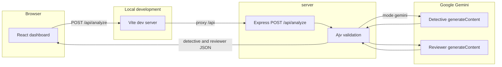

# BugLens AI

A local workspace for reading JavaScript and TypeScript, asking for a structured review, and comparing the submitted source with a complete corrected file.


BugLens AI is a self-initiated portfolio project. I built it to practice full-stack development and to try Concord MCP on a real split between a browser client and an analysis API. I directed the scope, the task split, the testing, and the integration troubleshooting. Cursor and Codex implemented the code. Concord MCP kept the shared task record. Google Gemini performs the analysis when the API is in Gemini mode.

The longer account of the architecture, the task history, the failures, and what I would change next is in the [technical report](PROJECT_REPORT.md).

## Why I built it

I wanted a project small enough to finish and sharp enough to show how I work. The product has a clear boundary: the browser owns the editor and the presentation, and the server owns validation, secrets, and the model calls. That split was a practical way to try multi-agent development. I could give the client and the server to different agents, keep a shared record of who owned which files, and hand work across that boundary when a feature needed both sides.

Concord MCP was the coordination layer for that experiment. It was not the bug detector. Gemini was the model behind the Detective and Reviewer roles.

## Features

The dashboard is a dark React application. Supported editor languages are JavaScript and TypeScript.

- **Monaco editor.** The submission editor uses Monaco. Local sample snippets are labeled as samples. **Analyze code** sends the current buffer. Ctrl+Enter submits as well.
- **Detective findings.** A successful response shows a summary and each finding’s severity, explanation, and optional title, line, and suggested fix.
- **AI Reviewer.** A second report shows whether the reviewer approved the result, plus feedback and concerns.
- **Suggested fixes.** When a finding includes `suggestedFix`, that text is shown with the finding.
- **Corrected code.** `detective.fixedCode` is rendered in a read-only Monaco editor when the API returns a complete corrected file.
- **Copy code.** The corrected-code panel has a **Copy code** button. It uses the clipboard API, then a textarea fallback, and reports **Copied** or a failure message.
- **Before/after diff.** Monaco’s diff editor compares the submitted source with the corrected source. The layout is side by side at viewport widths of 1024px and above, and inline below that.

The interface also has loading, empty, and error states. If `fixedCode` is empty, the panel says that no corrected code was generated, and the diff stays unavailable. Mock mode is explicit: the API says that no real analysis was performed, returns the original source as `fixedCode`, and sets `approved` to false. A generated fix still needs human review. The product does not claim that corrected code is secure.

## Screenshots

The dashboard includes the corrected-code panel and the before/after diff described above. This repository does not include captured images.

## Tech stack

| Layer | Choice |
| --- | --- |
| Frontend | React 19, TypeScript, Vite 8, Tailwind CSS 4 |
| Editor | Monaco Editor through `@monaco-editor/react` |
| Backend | Node.js 22 or newer, Express 5, Ajv |
| Analysis | Google Gemini `generateContent` over HTTPS. There is no Gemini SDK in `server/package.json`. |
| Frontend agent | Cursor, on `client/` |
| Backend agent | Codex, on `server/` |
| Coordination | Concord MCP |

`ANALYSIS_MODE=mock` skips Gemini. If the mode is unset, the server defaults to Gemini and requires `GEMINI_API_KEY`. A provider failure does not fall back to mock data.

## Architecture

The browser never receives the API key. In development, Vite serves the client and proxies `/api` to Express. Express validates the request, then either returns the mock payload or calls Gemini twice: Detective first, then Reviewer with the original source and the Detective report. Both model payloads are schema-checked before the HTTP response is sent.



`POST /api/analyze` accepts JSON `{ "code", "language" }` for `javascript` or `typescript`. Success returns `detective` and `reviewer`. The field reference and error statuses are documented in [server/README.md](server/README.md).

## How Concord MCP was used

I used Concord to register tasks, claim file scope, and keep a record that outlived a single chat. Cursor owned `client/`. Codex owned `server/`. When the corrected-source work crossed that boundary, I opened a server task and a client task instead of editing both trees from one session. Assignment and acceptance for the server task were recorded in Concord. Prompts between the sessions carried the contract: complete corrected source, no claim that a fix is secure, and no edits outside the owning tree.

These statuses are from the Concord workspace record on 6 November 2026:

| Task | Title | Agent | Status |
| --- | --- | --- | --- |
| BL-001 | Build BugLens Frontend | `cursor:a5e48e83` | complete |
| BL-002 | Build BugLens Analysis Backend | `codex:buglens-backend` | review_ready |
| BL-003 | Complete corrected source | `codex:buglens-backend` | complete |
| BL-004 | Corrected code panel | `cursor:a5e48e83` | complete |
| BL-005 | Safe structured backend diagnostics | `codex:buglens-backend` | complete |

BL-002 is still `review_ready`. BL-003 is the handoff I used when the corrected-file contract belonged on the server while the panel belonged on the client. The same record is written up with timestamps in the [technical report](PROJECT_REPORT.md).

## Getting started

Requirements: Node.js 22 or newer. The backend README asks for Node.js 22.13 or newer because the tests import the TypeScript client parser through Node’s type stripping. Do not commit `server/.env`.

### Backend

From `server/`:

```powershell
npm ci
Copy-Item .env.example .env
npm start
```

`npm run dev` runs the same process with Node’s watch mode. The example environment selects mock mode and leaves the key blank. Names in [server/.env.example](server/.env.example):

- `PORT` (example `3001`)
- `HOST` (example `127.0.0.1`)
- `ANALYSIS_MODE` (`mock` or `gemini`)
- `GEMINI_API_KEY`
- `GEMINI_MODEL` (example `gemini-2.5-flash`)
- `GEMINI_TIMEOUT_MS` (example `30000`)
- `CORS_ORIGINS` (example `http://localhost:5173,http://127.0.0.1:5173`)

For a real analysis, set `ANALYSIS_MODE=gemini` and provide `GEMINI_API_KEY` in the environment or in the ignored `.env`. Restart the API after changing the allowlist. The example file lists port 5173 only.

### Frontend

From `client/`:

```powershell
npm ci
npm run dev
```

Open the URL Vite prints. The dev server is configured for port 5173 and proxies `/api` to `http://localhost:3001`. Stay on an origin listed in `CORS_ORIGINS`. If Vite moves to another port, stop the process holding 5173 or add that exact origin and restart the API. Set `VITE_API_BASE` only when the client should call the API directly instead of through the proxy, and restart Vite after changing it.

Choose JavaScript or TypeScript, then use **Analyze code**. Mock mode will say that no real analysis was performed. Gemini mode sends the editor contents to Google.

## Testing

### Automated

On 6 November 2026, `npm test` in `server/` reported 21 passed and 0 failed. The run stubs the provider and does not call Gemini. It covers mock mode, the frontend response parser, invalid input, CORS allow and deny, the Detective-then-Reviewer request, sanitized failures, fence handling, an empty fix, and diagnostic logging.

During BL-004, `npm run lint` and `npm run build` in `client/` completed successfully. I did not re-run those two commands while writing this README. An earlier backend review packet recorded 9 passed tests. The suite has grown since then. The count I cite for the current tree is 21.

### User-confirmed manual tests

I ran the following in my local browser. This is a manual check. It is not an automated test.

1. I submitted JavaScript that contained an off-by-one loop error and hardcoded credentials.
2. The Detective reported three findings: one high-severity runtime error and two critical security concerns.
3. Gemini returned corrected JavaScript that fixed the off-by-one error.
4. The before/after diff showed those code changes correctly.
5. I confirmed that **Copy code** worked in my browser.

That session confirms the off-by-one repair, the three displayed findings, the diff, and the copy button. I am not treating it as proof that both credential findings were removed.

A separate agent-observed session, recorded in the technical report, checked empty, loading, findings, reviewer, and diff states on one local sample, and one live `POST /api/analyze` that returned HTTP 200. Copy failed in that embedded browser. That result does not replace the manual confirmation above.

## Technical report

The full write-up covers the request contract, the Concord timeline, the Gemini and CORS troubleshooting, security limits, and the lessons from the experiment:

**[PROJECT_REPORT.md](PROJECT_REPORT.md)**

Backend behavior and configuration are also in [server/README.md](server/README.md).

## Author

[Aya Aoulad Ahmidou](https://github.com/ayaAhd123)
